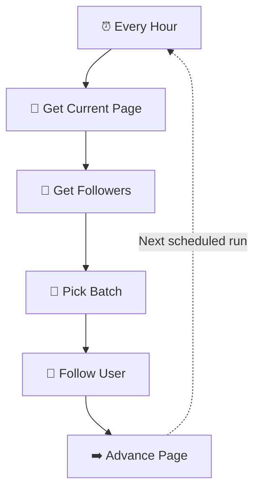
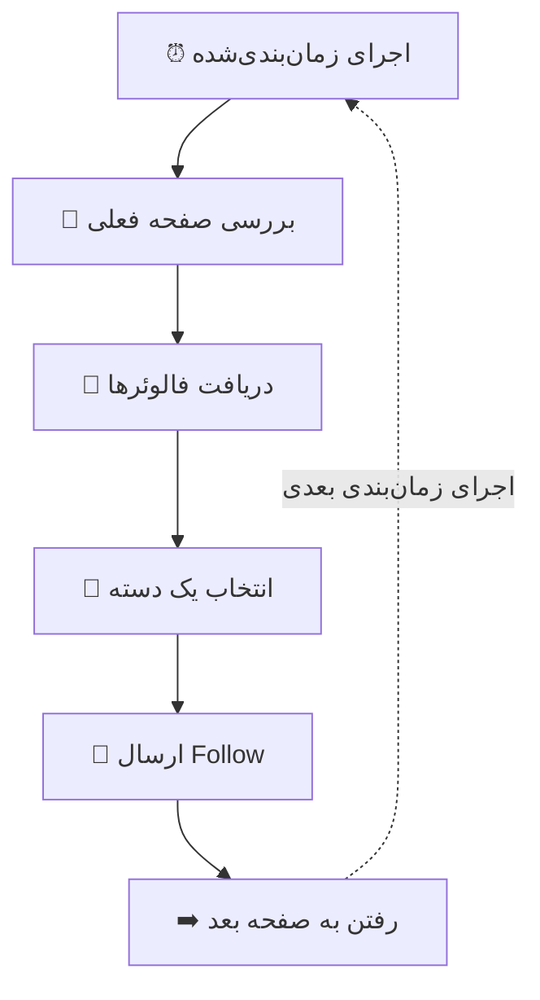

<div align="center">


# 🚀 GitHub Hourly Follow Automation

### Grow your GitHub network with n8n

**A configurable workflow template that automates following accounts from a selected GitHub profile's follower list.**

قالبی برای خودکارسازی فالو کردن کاربران گیت‌هاب با n8n، با هدف کمک به رشد شبکه و افزایش دیده‌شدن پروفایل.

<p>
  <a href="#english"></a>
  <a href="#فارسی"></a>
</p>

<p>
  
  
  
  
</p>

[**📦 View workflow**](workflows/github-hourly-follow.json) · [**🖼️ View banner**](assets/banner.svg) · [**⭐ Star this repo**](https://github.com/Royatvand/n8n-github-profile-follow)

</div>

---

<a id="english"></a>

## 🇬🇧 English

## 🎯 What is this project for?

The goal is simple: **help you grow your GitHub network and potentially attract more profile followers** by automating a repetitive part of networking.

The workflow retrieves accounts that follow a GitHub profile you choose, selects a batch, and sends follow requests through the GitHub API. Following relevant developers can sometimes increase profile visibility—but **there is no guarantee that anyone will follow you back**. A thoughtful profile, useful repositories, and genuine community participation still matter.

> [!IMPORTANT]
> This workflow is provided as an editable template and is **inactive by default**. Automated or high-volume following may be treated as spam and could violate GitHub policies. Use it conservatively, follow current platform rules, and avoid unsolicited mass-following.

## ✨ Highlights

| | Feature | Details |
|---|---|---|
| ⏰ | Scheduled runs | Hourly trigger configured for 08:00–17:00, <code>Asia/Tehran</code> |
| 👥 | Audience discovery | Reads the followers list of a configurable GitHub username |
| 🧩 | Batch processing | Selects up to 40 accounts per batch |
| 🔁 | Pagination | Advances through follower pages |
| 🐢 | Request spacing | Configured with a 1.5-second interval in the follow step |
| 🔐 | Safer template | Exported inactive; credential references removed |

## 🔄 How the workflow works



### 📁 Project structure

```text
n8n-github-profile-follow/
├── assets/
│   └── banner.svg
├── workflows/
│   └── github-hourly-follow.json
└── README.md
```

## ⚙️ Get started

1. **Download** [github-hourly-follow.json](workflows/github-hourly-follow.json).
2. Open n8n and choose **Import from File**.
3. Keep the workflow **inactive** while you review its nodes and settings.
4. In **Get Followers**, replace <code>YOUR_TARGET_USERNAME</code> with the intended public GitHub username.
5. Configure your GitHub credentials in both **Get Followers** and **Follow User**.
6. Review the schedule, pagination, batch size, permissions, and API limits. Test carefully with a small, controlled run.
7. Activate it only if your intended use complies with GitHub's current terms and policies.

## 📈 Tips for real GitHub growth

- **Follow relevant developers**, not random accounts.
- Make your profile README clear and keep your best projects easy to find.
- Publish useful code, document your projects, and contribute to repositories in your field.
- Avoid sudden, repetitive, or high-volume follow activity.
- Measure meaningful engagement over time; do not treat follow-backs as guaranteed.

## 🛡️ Security & responsible use

- Never commit access tokens, OAuth secrets, exported credentials, or private user data.
- The workflow JSON has been exported inactive and its credential references have been removed; configure credentials locally in n8n.
- The workflow targets accounts in the selected profile's followers list. It does not determine whether those accounts are relevant, whether you already follow them, or whether they will follow you back.
- Do not use the project to evade rate limits or conduct spam-like activity.
- Check GitHub's current documentation and policies before running it.

## 🧰 Requirements

- A working n8n instance.
- A GitHub credential configured inside n8n with the permissions required by the relevant API endpoints.
- Basic familiarity with n8n and the GitHub REST API.

## ⚠️ Disclaimer

This is an independent educational automation project. It is not affiliated with or endorsed by GitHub or n8n. Use responsibly and at your own risk.

---

<a id="فارسی"></a>

## 🇮🇷 فارسی

## 🎯 هدف پروژه چیه؟

هدف پروژه مشخصه: **کمک به رشد شبکه ارتباطی گیت‌هاب و بیشتر شدن احتمال دیده‌شدن پروفایل و جذب فالوئر** با خودکار کردن بخشی از فرایند فالو کردن.

این گردش‌کار فهرست دنبال‌کنندگان یک پروفایل انتخابی گیت‌هاب رو دریافت می‌کنه، تعدادی از حساب‌ها رو انتخاب می‌کنه و از طریق GitHub API درخواست Follow می‌فرسته. فالو کردن برنامه‌نویس‌های مرتبط ممکنه باعث بیشتر دیده‌شدن پروفایلت بشه؛ اما **هیچ تضمینی وجود نداره که اون‌ها هم تو رو فالو کنن**. پروفایل خوب، پروژه‌های کاربردی و مشارکت واقعی در جامعه برنامه‌نویسی همچنان مهم‌اند.

> [!IMPORTANT]
> این پروژه یک قالب قابل‌ویرایشه و به‌صورت پیش‌فرض **غیرفعال** منتشر شده. فالو خودکار یا پرتعداد ممکنه اسپم محسوب بشه و با سیاست‌های گیت‌هاب مغایرت داشته باشه. با احتیاط، در چارچوب قوانین و بدون فالو انبوه ناخواسته ازش استفاده کن.

## ✨ امکانات اصلی

| | قابلیت | توضیحات |
|---|---|---|
| ⏰ | اجرای زمان‌بندی‌شده | اجرای ساعتی در بازه ۰۸ تا ۱۷، با منطقه زمانی <code>Asia/Tehran</code> |
| 👥 | پیدا کردن مخاطب | دریافت فهرست فالوئرهای یک نام کاربری مشخص |
| 🧩 | پردازش دسته‌ای | انتخاب حداکثر ۴۰ حساب در هر دسته |
| 🔁 | صفحه‌بندی | رفتن به صفحه بعدی فهرست فالوئرها |
| 🐢 | فاصله بین درخواست‌ها | فاصله تنظیم‌شده ۱٫۵ ثانیه در مرحله Follow |
| 🔐 | قالب امن‌تر | فایل خروجی غیرفعال است و ارجاع‌های Credential از آن حذف شده‌اند |

## 🔄 روند اجرای گردش‌کار



### 📁 ساختار پروژه

```text
n8n-github-profile-follow/
├── assets/
│   └── banner.svg
├── workflows/
│   └── github-hourly-follow.json
└── README.md
```

## ⚙️ راه‌اندازی

1. فایل [github-hourly-follow.json](workflows/github-hourly-follow.json) رو دریافت کن.
2. وارد n8n شو و گزینه **Import from File** رو بزن.
3. هنگام بررسی تنظیمات، گردش‌کار رو **غیرفعال** نگه دار.
4. در نود **Get Followers** مقدار <code>YOUR_TARGET_USERNAME</code> رو با نام کاربری عمومی موردنظر جایگزین کن.
5. در هر دو نود **Get Followers** و **Follow User**، Credential گیت‌هاب رو تنظیم کن.
6. زمان‌بندی، صفحه‌بندی، اندازه دسته، مجوزها و محدودیت‌های API رو بررسی کن. اول یک آزمایش کوچک و کنترل‌شده انجام بده.
7. فقط زمانی فعالش کن که مطمئن شدی روش استفاده‌ات با قوانین جاری گیت‌هاب سازگاره.

## 📈 چطور واقعاً فالوئر گیت‌هاب رو بیشتر کنیم؟

- **برنامه‌نویس‌های مرتبط با حوزه خودت** رو دنبال کن، نه حساب‌های تصادفی.
- README پروفایلت رو مرتب کن و بهترین پروژه‌هات رو در معرض دید قرار بده.
- پروژه‌های کاربردی منتشر کن و برای هرکدوم توضیحات و راهنمای واضح بنویس.
- از فالو کردن پرتعداد، تکراری و ناگهانی دوری کن.
- رشد تعامل واقعی رو در طول زمان بررسی کن؛ فالو بک تضمینی نیست.

## 🛡️ امنیت و استفاده مسئولانه

- توکن دسترسی، رمز OAuth، خروجی Credential یا اطلاعات خصوصی کاربران رو در مخزن منتشر نکن.
- فایل JSON غیرفعال منتشر شده و ارجاع‌های Credential از اون حذف شده‌اند؛ اعتبارنامه‌ها رو فقط داخل n8n تنظیم کن.
- این گردش‌کار حساب‌های موجود در فهرست فالوئرهای پروفایل انتخابی رو هدف می‌گیره. مرتبط بودن حساب‌ها، فالو بودن قبلی یا فالو بک دادن اون‌ها رو بررسی نمی‌کنه.
- از پروژه برای دور زدن محدودیت API یا فعالیت‌های مشابه اسپم استفاده نکن.
- پیش از اجرا، مستندات و سیاست‌های فعلی گیت‌هاب رو بررسی کن.

## 🧰 پیش‌نیازها

- یک نمونه فعال از n8n.
- تنظیم Credential گیت‌هاب با مجوزهای لازم برای endpointهای مورد استفاده.
- آشنایی مقدماتی با n8n و GitHub REST API.

## ⚠️ سلب مسئولیت

این پروژه مستقل و آموزشی است و وابستگی یا تأیید رسمی از سوی GitHub یا n8n ندارد. استفاده از آن بر عهده خود کاربر است.

---

<div align="center">

**Built to grow your network, one meaningful connection at a time.**  
**برای رشد شبکه ارتباطی، با تمرکز روی ارتباط‌های ارزشمند.**

⭐ اگر پروژه برات مفید بود، به مخزن Star بده.

</div>
