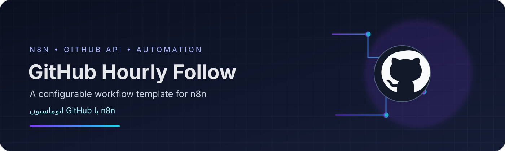

# GitHub Hourly Follow Automation

**A configurable n8n workflow template for learning GitHub API automation.**  
**قالب گردش‌کار n8n برای یادگیری اتوماسیون GitHub API**

[English](#english) · [فارسی](#فارسی)

---

## 🇬🇧 English

### Overview
This repository contains an importable n8n workflow template that demonstrates scheduled execution, paginated GitHub API requests, batch selection, and authenticated follow actions.

> **Important:** This is an automation example, not a growth guarantee. Automatically following people at scale may be considered spam and may violate GitHub's terms or acceptable-use rules. Use only with accounts and targets you are authorized to manage, review each action, and respect platform limits. The workflow is intentionally **inactive** in the exported JSON.

### Workflow at a glance
1. **Every Hour** — scheduled trigger, configured for hours 08:00–17:00 in the `Asia/Tehran` timezone.
2. **Get Current Page** — calculates pagination and batch parameters.
3. **Get Followers** — requests followers for a configurable GitHub username.
4. **Pick Batch** — selects a batch of up to 40 users.
5. **Follow User** — sends an authenticated GitHub API follow request, one item at a time with a 1.5-second interval.
6. **Advance Page** — updates the saved pagination offset.

### Files
- `workflows/github-hourly-follow.json` — workflow export for n8n.
- `assets/banner.svg` — repository banner.

### Requirements
- A running n8n instance.
- A GitHub API credential configured in n8n with the permissions required by the GitHub endpoint.
- Familiarity with n8n workflows and GitHub's API limits.

### Import and configure
1. Download `workflows/github-hourly-follow.json`.
2. In n8n, choose **Import from File** and select the downloaded JSON.
3. Keep the workflow inactive while reviewing and testing it.
4. In **Get Followers**, replace `YOUR_TARGET_USERNAME` with a username whose public follower list you are allowed to process.
5. Configure the GitHub credential on both HTTP Request nodes (**Get Followers** and **Follow User**).
6. Review the schedule, batch size, and follow action before any manual test. Start with a small, controlled test and monitor execution results and API limits.
7. Activate only if you understand the consequences and your use complies with GitHub's current rules.

### Security and responsible use
- Never commit personal access tokens, OAuth tokens, credential exports, or private user data.
- The exported workflow has been made inactive and credential references have been removed.
- The template follows accounts returned by the selected target user's followers endpoint. It does **not** verify whether each account is relevant or whether you already know them.
- Do not use it for unsolicited mass-following, evasion of rate limits, or other spam-like behavior.
- Check GitHub's current documentation and policies before use.

### Disclaimer
Provided for educational and personal automation experiments. Use at your own risk. This project is not affiliated with or endorsed by GitHub or n8n.

---

## 🇮🇷 فارسی

### معرفی
این مخزن شامل یک گردش‌کار قابل‌ورود به n8n است که اجرای زمان‌بندی‌شده، صفحه‌بندی درخواست‌های GitHub API، انتخاب دسته‌ای از کاربران و ارسال درخواست Follow را نمایش می‌دهد.

> **هشدار مهم:** این پروژه صرفاً یک نمونه آموزشی است و افزایش فالوئر را تضمین نمی‌کند. فالو کردن خودکار تعداد زیادی حساب ممکن است اسپم محسوب شود یا با قوانین و سیاست‌های GitHub مغایرت داشته باشد. فقط در محدوده مجاز و با بررسی نتایج از آن استفاده کن. فایل خروجی عمداً در حالت **غیرفعال** قرار گرفته است.

### گردش‌کار چگونه کار می‌کند؟
1. **Every Hour** — اجرا در ساعت‌های ۰۸ تا ۱۷ بر اساس منطقه زمانی `Asia/Tehran`.
2. **Get Current Page** — محاسبه شماره صفحه و اندازه دسته.
3. **Get Followers** — دریافت فهرست دنبال‌کنندگان یک نام کاربری مشخص در GitHub.
4. **Pick Batch** — انتخاب حداکثر ۴۰ کاربر در هر اجرا.
5. **Follow User** — ارسال درخواست Follow با اعتبارنامه GitHub و فاصله ۱٫۵ ثانیه بین درخواست‌ها.
6. **Advance Page** — به‌روزرسانی موقعیت صفحه‌بندی ذخیره‌شده.

### فایل‌های مخزن
- `workflows/github-hourly-follow.json` — فایل قابل ورود به n8n.
- `assets/banner.svg` — بنر گرافیکی مخزن.

### پیش‌نیازها
- نصب و اجرای n8n.
- تنظیم Credential مربوط به GitHub در n8n با مجوزهای لازم.
- آشنایی مقدماتی با گردش‌کارهای n8n و محدودیت‌های GitHub API.

### نصب و راه‌اندازی
1. فایل `workflows/github-hourly-follow.json` را دانلود کن.
2. در n8n گزینه **Import from File** را انتخاب و فایل JSON را وارد کن.
3. هنگام بررسی و آزمایش، گردش‌کار را غیرفعال نگه دار.
4. در نود **Get Followers** مقدار `YOUR_TARGET_USERNAME` را با نام کاربری موردنظر جایگزین کن.
5. Credential مربوط به GitHub را در هر دو نود **Get Followers** و **Follow User** تنظیم کن.
6. زمان‌بندی، تعداد کاربران هر دسته و عملکرد Follow را بررسی کن. ابتدا فقط یک آزمایش محدود انجام بده و گزارش اجرا و محدودیت API را زیر نظر بگیر.
7. فقط در صورتی گردش‌کار را فعال کن که از پیامدها آگاه باشی و استفاده‌ات با قوانین جاری GitHub سازگار باشد.

### امنیت و استفاده مسئولانه
- توکن دسترسی، اطلاعات ورود، خروجی Credential یا داده خصوصی کاربران را در مخزن قرار نده.
- نسخه منتشرشده غیرفعال است و شناسه‌های Credential از آن حذف شده‌اند.
- این گردش‌کار حساب‌های موجود در فهرست دنبال‌کنندگان کاربر هدف را دنبال می‌کند؛ ارتباط یا مناسب‌بودن آن حساب‌ها را بررسی نمی‌کند.
- از آن برای فالو انبوه ناخواسته، دور زدن محدودیت‌ها یا رفتارهای مشابه اسپم استفاده نکن.
- پیش از استفاده، مستندات و سیاست‌های فعلی GitHub را بررسی کن.

### سلب مسئولیت
این پروژه برای یادگیری و آزمایش اتوماسیون شخصی ارائه شده است. استفاده از آن بر عهده خود کاربر است و وابستگی یا تأیید رسمی از سوی GitHub یا n8n ندارد.

---

## 🏷️ Repository metadata

**Description (English):**  
`An educational n8n workflow template for scheduled GitHub API pagination and follow automation, with configurable targets and responsible-use guidance.`

**Topics / Tags:**  
`n8n`, `n8n-workflow`, `github-api`, `automation`, `workflow-automation`, `javascript`, `api-integration`, `developer-tools`

---

Made for learning automation · ساخته‌شده برای یادگیری اتوماسیون

